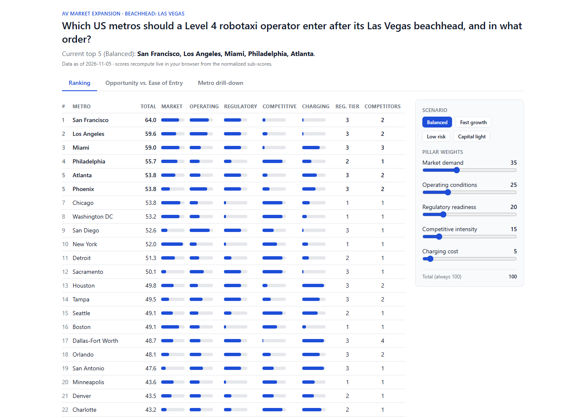
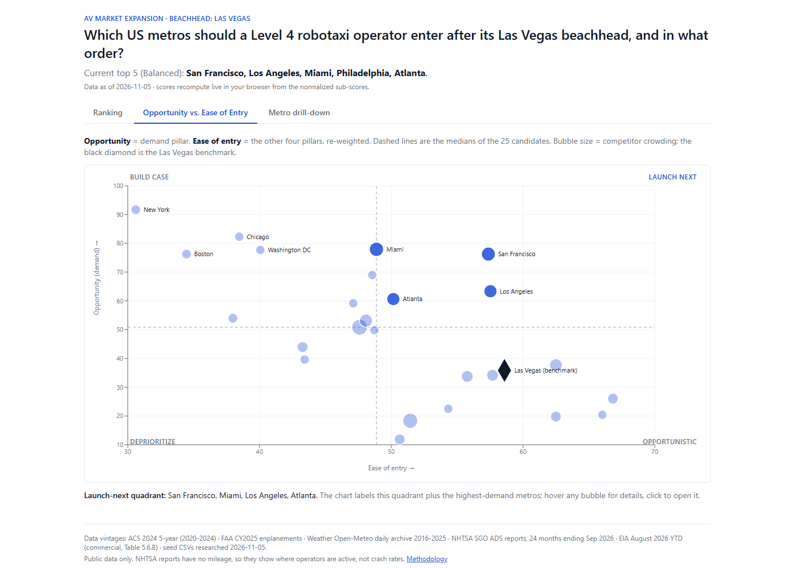
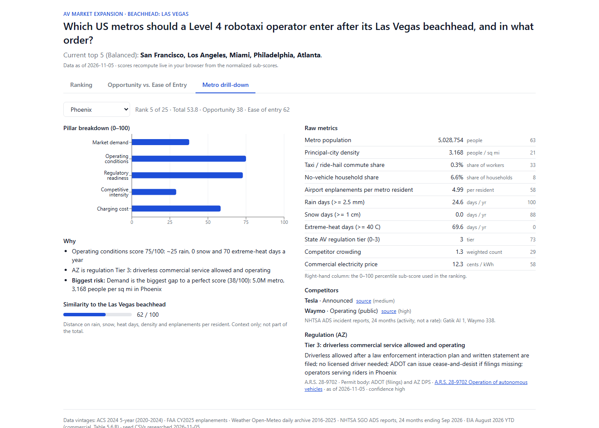
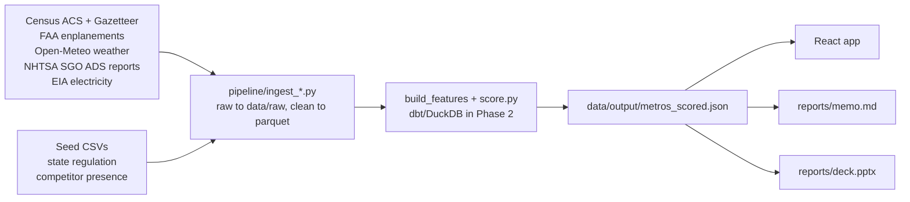

# AV Market Expansion Strategy

**The problem.** A Level 4 robotaxi operator has proven its service in Las Vegas and runs on a ride-hail platform partner. Which US metros should it enter next, in what order, and what will each one take? This project scores 25 candidate metros on the five criteria the AV industry uses to pick launch markets, estimates demand and unit economics, tests how stable the ranking is, and delivers the answer as an interactive app, an executive memo and a slide deck. The operator is kept generic: "the operator" and "the Las Vegas beachhead".

**Current recommendation (balanced weights, work in progress):** the top 5 are San Francisco, Los Angeles, Miami, Philadelphia and Atlanta/Phoenix (tied). The final recommendation is added in Phase 4.

## Screenshots

| Ranking | Opportunity vs. Ease of Entry | Metro drill-down |
|---|---|---|
|  |  |  |

## Architecture



## Quick start

```bash
python -m venv .venv && .venv/Scripts/python -m pip install -e .      # or pip install the dependencies in pyproject.toml
cp .env.example .env                                                  # add your free Census API key
make all                                                              # data, score, tests, memo, deck
cd app && npm install && npm run dev                                  # http://localhost:5173
```

No `make` on Windows? Run the commands listed in the [Makefile](Makefile) in order.

## Methodology in brief

Five pillars (demand 35, operating conditions 25, regulatory readiness 20, competitive intensity 15, charging cost 5). Every sub-metric becomes a 0-100 percentile rank across the 25 candidates. Pillar scores are weighted means, the total is the weighted mean of the pillars, and four weight scenarios are provided. Opportunity is the demand pillar and ease of entry is the other four. Las Vegas is scored on the same scale but not ranked. Full details: [docs/methodology.md](docs/methodology.md).

## Data sources

| Source | Vintage |
|---|---|
| Census ACS 5-year API | 2020-2024 |
| Census Gazetteer (places), CBSA delineation | 2025, 2023 |
| FAA passenger enplanements | CY2025 |
| Open-Meteo historical weather | 2016-2025 daily |
| NHTSA Standing General Order, ADS reports | 24 months ending Sep 2026 |
| EIA Table 5.6.B, commercial price | Jan-Aug 2026 year to date |
| Seed: state AV regulation (17 states) | researched 2026-11-05 |
| Seed: competitor presence (42 rows) | researched 2026-11-05 |

Details and caveats: [docs/data_sources.md](docs/data_sources.md). Profiles of every step are in [data/profiles/](data/profiles/).

## Limitations

- Public data only.
- NHTSA reports have no mileage, so they are used as evidence of where operators are active and never as crash rates.
- Regulation and competitor status are as of 2026-11-05 and some rows are low or medium confidence (listed in `data/profiles/07_seed_and_crosscheck.md`).
- Demand is an estimate from two anchors (Phase 3), not a forecast.
- The EIA price is a year-to-date average, not a 12-month average.
