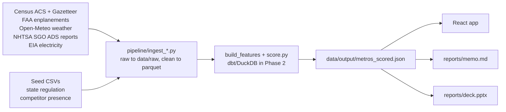

# AV Market Expansion Strategy

**The problem.** A Level 4 robotaxi operator has proven its service in Las Vegas and runs on a ride-hail platform partner. Which US metros should it enter next, in what order, and what will each one take? This project scores 25 candidate metros on the five criteria the AV industry uses to pick launch markets, estimates demand and unit economics, tests how stable the ranking is, and delivers the answer as an interactive app, an executive memo and a slide deck. The operator is kept generic: "the operator" and "the Las Vegas beachhead".

**Recommendation (balanced weights, data as of 2026-11-06).** Enter Miami, San Francisco, Los Angeles and Phoenix first, then Atlanta, Detroit and Philadelphia; hold Chicago, New York and Boston until the rules change.

| Wave | Metros | Gate |
|---|---|---|
| 1 | Miami, San Francisco, Los Angeles and Phoenix | Tier 2+ state rules and top 5 in at least half of 10,000 weight draws (Miami 96%, San Francisco 87%, Los Angeles 63%, Phoenix 50%) |
| 2 | Atlanta, Detroit and Philadelphia | Tier 2+ rules, top 10; weather and permits to validate (Atlanta 39%, Detroit 26%, Philadelphia 10%) |
| 3 | Chicago, New York and Boston | Top-10 demand, but driverless commercial service is not yet allowed |

Miami, San Francisco, Los Angeles and Phoenix already have operating competitors, so wave 1 is a bet on demand and rules, not on an open field. California is Tier 3 but slow for a new entrant (separate DMV and CPUC permits). Dallas-Fort Worth (#13) and Houston (#14) are in no wave: see the memo for why. Read the one-page memo ([reports/memo.md](reports/memo.md)) and the 7-slide deck (`reports/deck.pptx`) for the reasoning and risks.

## Screenshots

| Ranking | Opportunity vs. Ease of Entry | Metro drill-down |
|---|---|---|
|  |  |  |

## Architecture



## Quick start

```bash
python -m venv .venv && .venv/Scripts/python -m pip install -e .      # or pip install the dependencies in pyproject.toml
cp .env.example .env                                                  # add your free Census API key
```

Run the pipeline with either `make` (macOS/Linux) or `tasks.py` (any OS, including Windows without `make`). They run the same steps.

| Step | With make | Without make |
|---|---|---|
| Everything: data, score, analysis, dbt, tests, memo, deck | `make all` | `python tasks.py all` |
| Ingest sources | `make data` | `python tasks.py data` |
| Score, analysis, publish JSON to the app | `make score` | `python tasks.py score` |
| dbt build + Python-vs-dbt parity check | `make dbt` | `python tasks.py dbt` |
| pytest + vitest | `make test` | `python tasks.py test` |
| Memo / deck | `make memo` / `make deck` | `python tasks.py memo` / `python tasks.py deck` |
| Refresh README screenshots (Playwright, needs Edge or Chrome) | n/a | `python tasks.py screenshots` |

`tasks.py` uses `.venv` automatically when it exists. Then start the app:

```bash
cd app && npm install && npm run dev                                  # http://localhost:5173
```

## Methodology in brief

Five pillars (demand 35, operating conditions 25, regulatory readiness 20, competitive intensity 15, charging cost 5). Every sub-metric becomes a 0-100 percentile rank across the 25 candidates. Pillar scores are weighted means, the total is the weighted mean of the pillars, and four weight scenarios are provided. Opportunity is the demand pillar and ease of entry is the other four. Demand is calibrated on two anchors (Chicago and NYC ride-hail trips), unit economics use labeled assumptions, and a 10,000-draw Monte Carlo on the weights gives each metro's top-5 confidence. Las Vegas is scored on the same scale but not ranked. Full details: [docs/methodology.md](docs/methodology.md).

## Data sources

| Source | Vintage |
|---|---|
| Census ACS 5-year API | 2020-2024 |
| Census Gazetteer (places), CBSA delineation | 2025, 2023 |
| FAA passenger enplanements | CY2025 |
| Open-Meteo historical weather | 2016-2025 daily |
| NHTSA Standing General Order, ADS reports | 24 months ending Sep 2026 |
| EIA Table 5.6.B, commercial price | Jan-Aug 2026 year to date |
| Seed: state AV regulation and new-entrant path (17 states) | researched 2026-11-06 |
| Seed: competitor presence (51 rows, all 26 metros) | researched 2026-11-06 |

Details and caveats: [docs/data_sources.md](docs/data_sources.md). Profiles of every step are in [data/profiles/](data/profiles/).

## Limitations

- Public data only.
- NHTSA reports have no mileage, so they are used as evidence of where operators are active and never as crash rates.
- Regulation and competitor status are as of 2026-11-06 and some rows are low or medium confidence (listed in `data/profiles/07_seed_and_crosscheck.md`).
- Demand is an estimate from two anchors (Phase 3), not a forecast.
- The EIA price is a year-to-date average, not a 12-month average.
